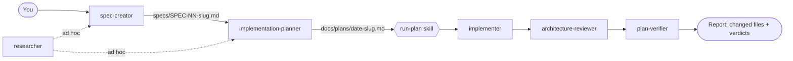

# sdd-engineering

A spec-driven development (SDD) pipeline for Claude Code: write a spec, plan the implementation, implement it,
review the architecture, and verify the result against the plan. Each stage is a separate, isolated agent with a fixed
hand-back format, so a stage never grades its own work.

## Install

```
claude plugin marketplace add <org>/dev-digest-marketplace
claude plugin install sdd-engineering@dev-digest-marketplace
```

Installing this plugin automatically installs its three dependencies:

| Dependency | Range | Provides |
|---|---|---|
| `engineering-paved-path` | `^1.0.0` | framework and practice skills the planner and implementer load |
| `research-tools` | `^1.0.0` | read-only `researcher` agent |
| `architecture-review` | `^1.0.0` | read-only `architecture-reviewer` agent |

## How it works



1. **`spec-creator`** turns a request into one short EARS-style spec. It cannot ask questions (subagents have no
   interactive tool), so every unanswered point becomes `[NEEDS CLARIFICATION: ...]`, echoed in its hand-back.
2. **`implementation-planner`** checks the spec is complete (otherwise `Status: BLOCKED` with questions), then writes a
   file-by-file plan with Interfaces, Done-when, Verification, Out of scope and Do-not-touch. It always asks you to pick
   an execution mode: multi-agent or single-pass.
3. **`run-plan`** (skill, `/sdd-engineering:run-plan`) drives `implementer` then `architecture-reviewer` then
   `plan-verifier` as separate agent calls. It stops at the first gating failure, never commits, stages or pushes, and
   hands back the changed files plus each verdict.
4. **`implementer`** executes the plan and loads the matching `engineering-paved-path` skills before touching the files they govern.
5. **`architecture-reviewer`** (from `architecture-review`) is advisory: findings carry file:line, a quote and a named rule.
6. **`plan-verifier`** re-runs the plan's Verification commands itself and gives each requirement `MET` or `NOT MET` with evidence.
7. **`workflow-retro`** (skill, manual) reports token use, launch order, timing and gaps of the multi-agent run that just happened.

Status values: implementer `COMPLETE / PARTIAL / BLOCKED`, verifier `PASS / FAIL / BLOCKED`, reviewer
`CLEAN / VIOLATIONS / PARTIAL`, planner `READY FOR IMPLEMENTER / BLOCKED / NO PLAN NEEDED`.

## Agents and skills

| Name | Type | Invoke as |
|---|---|---|
| spec-creator | agent | `sdd-engineering:spec-creator` |
| implementation-planner | agent | `sdd-engineering:implementation-planner` |
| implementer | agent | `sdd-engineering:implementer` |
| plan-verifier | agent | `sdd-engineering:plan-verifier` |
| run-plan | skill | `/sdd-engineering:run-plan <plan path>` |
| workflow-retro | skill | `/sdd-engineering:workflow-retro` |

## Quick start

```
Use sdd-engineering:spec-creator to write a spec for "export the report as CSV".
Use sdd-engineering:implementation-planner on specs/SPEC-01-csv-export.md.
/sdd-engineering:run-plan docs/plans/2026-10-21-csv-export.md
```

More examples: [docs/usage.md](docs/usage.md). Stage contracts: [docs/pipeline.md](docs/pipeline.md).

## Defaults and conventions

- Specs go to `specs/`, plans to `docs/plans/`; pass another path in your prompt to override.
- Verification commands come from the plan, or from the target repo's `package.json` scripts and CI files at run time. Nothing is assumed.
- The plugin reads `CLAUDE.md`, `AGENTS.md`, `README.md` and `CONTRIBUTING.md` of the target repo when present.

## Evals

`evals/` holds `claude plugin eval` cases (needs Claude Code 2.1.269+):

```
claude plugin eval ./plugins/sdd-engineering --runs 1
```

Evals spend tokens and are not part of CI validation. Results are written to `evals/results/` (gitignored).

## Versioning

Semver in `.claude-plugin/plugin.json`; history in [CHANGELOG.md](CHANGELOG.md). Releases are tagged
`sdd-engineering--vX.Y.Z` by the marketplace Release workflow. Dependencies must be released (tagged) first,
because the `^1.0.0` ranges resolve against their tags. A breaking change in a dependency is a major bump.

Differences from the original DevDigest agents: [docs/generalization.md](docs/generalization.md).
