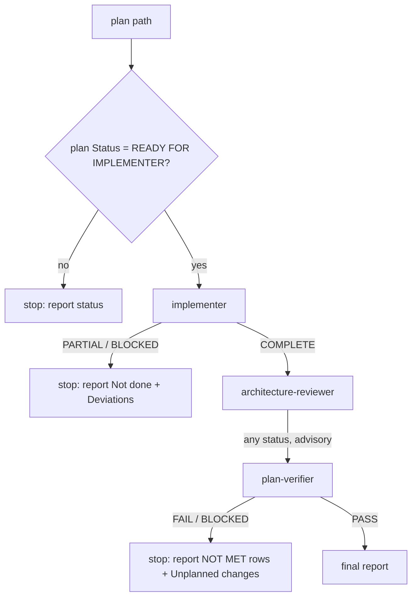

# Pipeline contracts

Every stage is an isolated subagent: it does not see the caller's conversation, so each is fully briefed by its
input (a request, a spec path, a plan path). Hand-offs happen through files on disk and the hand-back text.

| Stage | Input | Output | Writes | Statuses |
|---|---|---|---|---|
| spec-creator | request (+ optional design material) | one spec `specs/SPEC-NN-<slug>.md` | the spec only | `COMPLETE`, `BLOCKED` |
| implementation-planner | spec path or pasted spec | one plan `docs/plans/<date>-<slug>.md` | the plan only | `READY FOR IMPLEMENTER`, `BLOCKED`, `NO PLAN NEEDED` |
| implementer | plan path | code changes + hand-back | product files | `COMPLETE`, `PARTIAL`, `BLOCKED` |
| architecture-reviewer | plan path / diff | findings (file:line, quote, rule) | nothing | `CLEAN`, `VIOLATIONS`, `PARTIAL` |
| plan-verifier | plan path (+ earlier hand-backs) | checklist, one row per requirement | nothing | `PASS`, `FAIL`, `BLOCKED` |

## run-plan gating

Rules that never change:
- `run-plan` never commits, stages, pushes or opens a PR; the deliverable is changed files on disk.
- Stages run sequentially in the foreground; each depends on files the previous one left.
- The reviewer never halts a run; its findings are folded into the final report.
- The verifier re-runs commands itself and treats anything it cannot verify as `NOT MET`. It never fixes anything.

## Why a stage cannot ask questions

Subagents have no interactive tool. So unclear points travel as data: `[NEEDS CLARIFICATION: ...]` in a spec,
`Status: BLOCKED` with questions from the planner. The planner's execution-mode question is posed to you through its
hand-back, never answered on your behalf.
